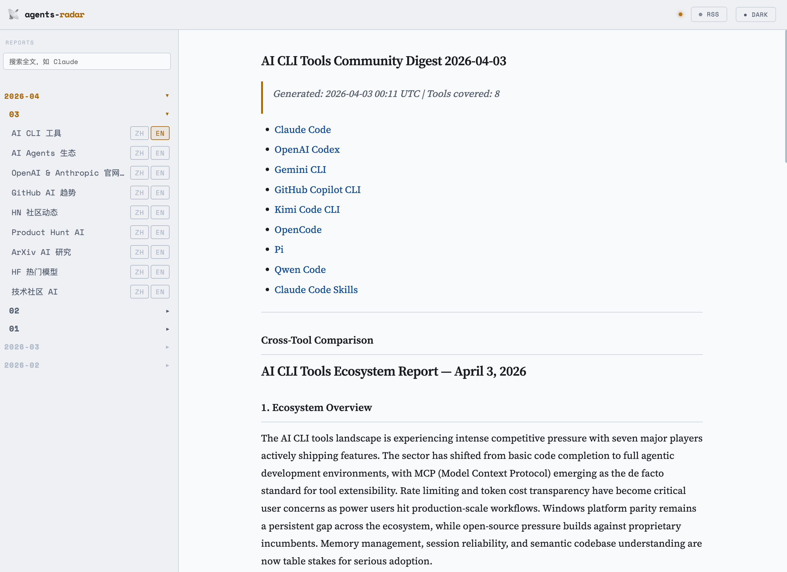

# ai-radar

A GitHub Actions workflow that runs every day at 21:03 UTC (06:03 KST). It aggregates AI ecosystem signals from 10 data sources, then publishes English daily digests as GitHub Issues and committed Markdown files.

### Data Sources

| Source | Type | Data |
|--------|------|------|
| [GitHub Repos](https://github.com) | API | Issues, PRs, releases from 18 tracked AI tool repos |
| [Claude Code Skills](https://github.com/anthropics/skills) | API | Trending skills sorted by community engagement |
| [GitHub Trending](https://github.com/trending) | HTML + API | Daily trending repos + AI topic search (7-day window) |
| [Hacker News](https://news.ycombinator.com) | [Algolia API](https://hn.algolia.com/api) | Top 30 AI stories from last 24h, 6 parallel queries |
| [Product Hunt](https://www.producthunt.com) | GraphQL API | Yesterday's top AI products by votes |
| [ArXiv](https://arxiv.org) | [ArXiv API](https://export.arxiv.org/api/query) | Latest papers from cs.AI, cs.CL, cs.LG (last 48h) |
| [Hugging Face](https://huggingface.co) | [Hub API](https://huggingface.co/api/models) | 30 trending models sorted by weekly likes — **weekly**, Mondays only |
| [Dev.to](https://dev.to) | [Forem API](https://dev.to/api) | Top AI/LLM articles from 5 tags |
| [Lobste.rs](https://lobste.rs) | JSON API | AI/ML tagged stories from last 7 days |
| [Anthropic](https://anthropic.com) + [OpenAI](https://openai.com) | Sitemap | New articles detected via `lastmod` diff |

## Web UI

**[https://huggerhustle.github.io/ai-radar](https://huggerhustle.github.io/ai-radar)**

Browse all historical digests in a clean, dark-themed interface — no login required. Reports are rendered from the Markdown files in this repo via GitHub Pages.



## Slack notifications

When `SLACK_BOT_TOKEN` and `SLACK_CHANNEL_ID` are set, each run posts one Slack message linking to each of that day's reports on GitHub, with highlights. See [Add Secrets](#3-add-secrets).

## RSS Feed

**[https://huggerhustle.github.io/ai-radar/feed.xml](https://huggerhustle.github.io/ai-radar/feed.xml)**

Subscribe in any RSS reader (Feedly, Reeder, NewsBlur, etc.) to receive new digests automatically. The feed includes the latest 30 reports across all report types, updated daily alongside `manifest.json`.

## MCP Server

**`https://ai-radar-mcp.<account>.workers.dev`** — replace `<account>` with the workers.dev subdomain of the Cloudflare account the worker is deployed to.

A [Model Context Protocol](https://modelcontextprotocol.io) server that exposes ai-radar data as tools. Any MCP-compatible client (Claude Desktop, OpenClaw, etc.) can query the latest AI ecosystem reports directly.

**Available tools:**

| Tool | Description |
|------|-------------|
| `list_reports` | List available dates and report types (last N days) |
| `get_latest` | Fetch the most recent report of a given type |
| `get_report` | Fetch a specific report by date and type |
| `search` | Keyword search across recent reports |

**Claude Desktop setup** — add to `~/Library/Application Support/Claude/claude_desktop_config.json`:

```json
{
  "mcpServers": {
    "ai-radar": {
      "url": "https://ai-radar-mcp.<account>.workers.dev"
    }
  }
}
```

Restart Claude Desktop after saving. You can then ask Claude things like:
- *"What's the latest in AI CLI tools?"* → calls `get_latest`
- *"Search for Claude Code mentions this week"* → calls `search`
- *"Show me the AI trending report for 2026-03-05"* → calls `get_report`

**OpenClaw setup** — run the following command:

```bash
openclaw mcp add --transport http ai-radar https://ai-radar-mcp.<account>.workers.dev
```

Or add it manually to `~/.openclaw/openclaw.json`:

```json
{
  "mcpServers": {
    "ai-radar": {
      "type": "http",
      "url": "https://ai-radar-mcp.<account>.workers.dev"
    }
  }
}
```

You can then ask OpenClaw things like:
- *"What's the latest in AI CLI tools?"* → calls `get_latest`
- *"Search for Claude Code mentions this week"* → calls `search`
- *"Show me the AI trending report for 2026-03-05"* → calls `get_report`

**Self-hosting** — deploy your own instance from the `mcp/` directory:

```bash
cd mcp
pnpm install
wrangler deploy
```

## Tracked sources

### AI CLI tools (GitHub)

| Tool | Repository |
|------|-----------|
| Claude Code | [anthropics/claude-code](https://github.com/anthropics/claude-code) |
| OpenAI Codex | [openai/codex](https://github.com/openai/codex) |
| Gemini CLI | [google-gemini/gemini-cli](https://github.com/google-gemini/gemini-cli) |
| GitHub Copilot CLI | [github/copilot-cli](https://github.com/github/copilot-cli) |
| OpenCode | [anomalyco/opencode](https://github.com/anomalyco/opencode) |
| Pi | [earendil-works/pi](https://github.com/earendil-works/pi) |
| Qwen Code | [QwenLM/qwen-code](https://github.com/QwenLM/qwen-code) |

Repos marked `discussions: true` in `config.yml` (Codex, Pi) also have their GitHub Discussions
pulled in.

### Claude Code Skills (GitHub)

| Source | Repository |
|--------|-----------|
| Claude Code Skills | [anthropics/skills](https://github.com/anthropics/skills) |

PRs and issues are fetched without a date filter and sorted by popularity (comment count), so the report always reflects the most actively discussed skills — not just the newest.

### OpenClaw + AI agent ecosystem (GitHub)

OpenClaw is tracked as the primary reference project, alongside several peer projects in the personal AI assistant / autonomous agent space for cross-ecosystem comparison.

| Project | Repository | Stars |
|---------|-----------|-------|
| OpenClaw | [openclaw/openclaw](https://github.com/openclaw/openclaw) | 387.8k |
| Hermes Agent | [nousresearch/hermes-agent](https://github.com/nousresearch/hermes-agent) | 237.0k |
| QwenPaw | [agentscope-ai/QwenPaw](https://github.com/agentscope-ai/QwenPaw) | 34.5k |
| ZeroClaw | [zeroclaw-labs/zeroclaw](https://github.com/zeroclaw-labs/zeroclaw) | 32.7k |
| IronClaw | [nearai/ironclaw](https://github.com/nearai/ironclaw) | 12.6k |

### AI infrastructure (GitHub)

The inference and serving layer the agent/CLI tools run on top of — tracked in a dedicated report with its own cross-project comparison.

| Project | Repository | Layer | Stars |
|---------|-----------|-------|-------|
| Ollama | [ollama/ollama](https://github.com/ollama/ollama) | Local runtime | 177.2k |
| llama.cpp | [ggml-org/llama.cpp](https://github.com/ggml-org/llama.cpp) | Inference engine | 121.9k |
| vLLM | [vllm-project/vllm](https://github.com/vllm-project/vllm) | Serving engine | 87.5k |
| Unsloth | [unslothai/unsloth](https://github.com/unslothai/unsloth) | Fine-tuning | 69.0k |
| LiteLLM | [BerriAI/litellm](https://github.com/BerriAI/litellm) | LLM gateway | 55.0k |
| SGLang | [sgl-project/sglang](https://github.com/sgl-project/sglang) | Serving engine | 30.9k |

Summaries focus on new model/hardware support, performance work, breaking changes, and what each change means for developers building on top of these projects.

### GitHub AI Trending

Two data sources are fetched in parallel every day:

| Source | Details |
|--------|---------|
| [github.com/trending](https://github.com/trending?since=daily) | Today's trending repos — parsed from HTML; includes today's new star count |
| GitHub Search API | Repos active in the last 7 days matching 6 AI topics: `llm`, `ai-agent`, `rag`, `vector-database`, `large-language-model`, `machine-learning` |

The LLM filters out non-AI repos from the trending list, classifies the rest by dimension (AI infrastructure / agents / applications / models / RAG), and extracts trend signals.

### Hacker News

Top AI stories from the last 24 hours, fetched via the [Algolia HN Search API](https://hn.algolia.com/api). Six queries run in parallel (`AI`, `LLM`, `Claude`, `OpenAI`, `Anthropic`, `machine learning`), results are deduplicated and ranked by points. The top 30 stories are passed to the LLM for analysis.

### Official web content (sitemap-based)

| Organization | Site | Tracked sections |
|---|---|---|
| Anthropic | [anthropic.com](https://www.anthropic.com) | `/news/`, `/research/`, `/engineering/`, `/learn/` |
| OpenAI | [openai.com](https://openai.com) | research, publication, release, company, engineering, milestone, learn-guides, safety, product |

New articles are detected by comparing sitemap `lastmod` timestamps against a persisted state file (`digests/web-state.json`). On the **first run**, up to 25 recent articles per site are fetched and a comprehensive overview report is generated. On subsequent runs, only new or updated URLs trigger a report; if nothing changed, the web report step is skipped entirely.

## Features

- Fetches issues, pull requests, and releases updated in the last 24 hours across all tracked repos
- Tracks trending Claude Code Skills — sorted by community engagement, not recency
- Generates a per-tool summary for each CLI repository and a cross-tool comparative analysis
- Generates a deep OpenClaw project report plus a cross-ecosystem comparison against 4 peer projects
- Tracks 6 AI infrastructure projects (inference engines, gateways, fine-tuning) with a dedicated report and cross-project comparison
- Scrapes official Anthropic and OpenAI web content via sitemaps; detects new articles incrementally
- Monitors GitHub Trending daily + searches 6 AI topic tags; classifies repos by dimension and extracts trend signals
- Fetches top-30 AI stories from Hacker News (last 24h, ranked by points); generates community sentiment report
- Publishes GitHub Issues for each report type; commits Markdown files to `digests/YYYY-MM-DD/`
- Runs on a daily schedule via GitHub Actions; supports manual triggering
- All tracked repositories are configurable via `config.yml` — no code changes needed

## Setup

### 1. Clone this repository

### 2. Customize `config.yml` (optional)

Edit `config.yml` in the repo root to add, remove, or replace the tracked repositories. The file is fully commented. No code changes are needed — the pipeline reads it on every run and falls back to built-in defaults if the file is absent.

```yaml
# Add a new CLI tool
cli_repos:
  - id: my-tool
    repo: owner/my-ai-cli
    name: My AI Tool

# Add a new peer project to the OpenClaw ecosystem comparison
openclaw_peers:
  - id: my-agent
    repo: owner/my-agent
    name: My Agent

# Add a new AI infrastructure project
infra_repos:
  - id: my-engine
    repo: owner/my-engine
    name: My Engine
    paginated: true   # for repos with >100 daily issue/PR updates
```

### 3. Add Secrets

Go to **Settings → Secrets and variables → Actions** and add:

| Secret | Required | Description |
|--------|----------|-------------|
| `OPENROUTER_API_KEY` | yes | [OpenRouter](https://openrouter.ai/keys) API key — every LLM call goes through it |
| `PRODUCTHUNT_TOKEN` | optional | Product Hunt API token; without it the Product Hunt report is skipped |
| `SLACK_BOT_TOKEN` | optional | Slack bot token (`xoxb-…`) with the `chat:write` scope |
| `SLACK_CHANNEL_ID` | optional | ID of the channel to post to (e.g. `C0123456789`) |

> `GITHUB_TOKEN` is provided automatically by GitHub Actions.

**Setting up Slack notifications** (optional):
1. Create a Slack app at [api.slack.com/apps](https://api.slack.com/apps) and add the `chat:write` bot scope
2. Install it to the workspace and copy the **Bot User OAuth Token** (`xoxb-…`)
3. Invite the bot to the channel (`/invite @your-bot`) and copy the channel ID from the channel's details
4. Add `SLACK_BOT_TOKEN` and `SLACK_CHANNEL_ID` as repository secrets

> If either secret is missing, the notification step is skipped.

### 3. Enable the workflow

Confirm the workflow is enabled in the **Actions** tab.

To test immediately, go to **Actions → Daily AI Radar → Run workflow**.

> **First run note**: The web content step will fetch up to 50 articles (25 per site) and may take a few extra minutes. Subsequent runs are fast — only new articles are processed.

## LLM

Every LLM call goes through [OpenRouter](https://openrouter.ai), so any model it lists works without a code change.

| Env var | Default |
|---------|---------|
| `OPENROUTER_API_KEY` | — (required) |
| `OPENROUTER_MODEL` | `deepseek/deepseek-v4.1-flash` |

Reasoning is turned off on every request: reasoning tokens count against the output budget and would cut reports short.

## Running locally

```bash
pnpm install

export GITHUB_TOKEN=ghp_xxxxx

export OPENROUTER_API_KEY=sk-or-xxxxxxxx
# export OPENROUTER_MODEL=deepseek/deepseek-v4.1-flash   # any OpenRouter model id

export DIGEST_REPO=your-username/ai-radar  # optional; omit to only write files

pnpm start
```

## Output format

Files are written to `digests/YYYY-MM-DD/`:

| File | Content | GitHub Issue label |
|------|---------|-------------------|
| `ai-cli.md` | CLI digest — cross-tool comparison + per-tool details | `digest` |
| `ai-agents.md` | OpenClaw deep report + cross-ecosystem comparison + 4 peer details | `openclaw` |
| `ai-infra.md` | AI infrastructure digest — cross-project comparison + per-project details | `infra` |
| `ai-web.md` | Official web content report (only written when new content exists) | `web` |
| `ai-trending.md` | GitHub AI trending report — repos classified by dimension + trend signals (only written when data is available) | `trending` |
| `ai-hn.md` | Hacker News AI community digest — top stories + sentiment analysis (only written when fetch succeeds) | `hn` |
| `ai-ph.md` | Product Hunt AI products digest (only written when `PRODUCTHUNT_TOKEN` is set and data is available) | `ph` |
| `ai-arxiv.md` | ArXiv AI research digest — key papers from cs.AI/cs.CL/cs.LG | `arxiv` |
| `ai-hf.md` | Hugging Face trending models digest — sorted by weekly likes (**weekly**: written on Mondays only) | `hf` |
| `ai-community.md` | Tech community AI digest — Dev.to articles + Lobste.rs stories combined | `community` |

A shared state file `digests/web-state.json` tracks which web URLs have been seen; it is committed alongside the daily digests.

---

`ai-cli.md` structure:
```
## Cross-Tool Comparison
  Ecosystem overview / Activity comparison table / Shared themes / Differentiation / Trend signals

## Per-Tool Reports
  <details> Claude Code    — [Claude Code Skills Highlights]
                             Top skills / Community demand trends / High-potential pending skills
                             ---
                             Today's summary / Hot issues / PR progress / Trends
  <details> OpenAI Codex   — Today's summary / Hot issues / PR progress / Trends
  <details> Gemini CLI     — ...
  <details> GitHub Copilot CLI — ...
  <details> OpenCode       — ...
  <details> Pi             — ...
  <details> Qwen Code      — ...
```

`ai-agents.md` structure:
```
Issues: N | PRs: N | Projects covered: 5

## OpenClaw Deep Dive
  Today's summary / Releases / Project progress / Community highlights /
  Bug stability / Feature requests / User feedback / Backlog

## Cross-Ecosystem Comparison
  Ecosystem overview / Activity table / OpenClaw positioning /
  Shared technical directions / Differentiation / Community maturity / Trend signals

## Peer Project Reports
  <details> ZeroClaw     — Today's summary / Releases / Progress / ... (8 sections)
  <details> Hermes Agent — ...
  <details> IronClaw     — ...
  <details> QwenPaw      — ...
```

`ai-infra.md` structure:
```
Projects covered: 6

## Cross-Project Comparison
  Ecosystem overview / Activity table / Model support race /
  Performance frontier / Layer positioning / Trend signals

## Per-Project Reports
  <details> vLLM       — Today's highlights / Releases & breaking changes /
                         New model & hardware support / Performance & optimization /
                         Stability & regressions / What it means for app developers
  <details> SGLang     — ...
  <details> llama.cpp  — ...
  <details> Ollama     — ...
  <details> LiteLLM    — ...
  <details> Unsloth    — ...
```

`ai-web.md` structure:
```
Sources: anthropic.com (N articles) + openai.com (N articles)

Today's summary
Anthropic / Claude highlights  (news / research / engineering / learn)
OpenAI highlights              (research / release / company / safety / ...)
Strategic signals
Notable details
[First full crawl also includes: Content landscape overview]
```

`ai-trending.md` structure:
```
Sources: GitHub Trending + GitHub Search API

Today's summary
Top repos by dimension
  🔧 AI Infrastructure  — frameworks / SDKs / inference engines / CLIs
  🤖 AI Agents          — agent frameworks / multi-agent / automation
  📦 AI Applications    — vertical products / solutions
  🧠 Models & Training  — model weights / training frameworks / fine-tuning
  🔍 RAG & Knowledge    — vector databases / retrieval augmentation
Trend signal analysis
Community focus
```

`ai-hn.md` structure:
```
Sources: Hacker News (top-30 AI stories, last 24h)

Today's summary
Top stories & discussions
  🔬 Models & Research  — new model releases / papers / benchmarks
  🛠️ Tools & Engineering — open-source projects / frameworks / engineering practice
  🏢 Industry news      — company news / funding / product launches
  💬 Opinions & debate  — Ask HN / Show HN / hot threads
Community sentiment signals
Worth reading
```

Historical digests are stored in [`digests/`](./digests/). Published issues are tagged by type: [`digest`](../../issues?q=is%3Aissue+label%3Adigest) · [`openclaw`](../../issues?q=is%3Aissue+label%3Aopenclaw) · [`web`](../../issues?q=is%3Aissue+label%3Aweb) · [`trending`](../../issues?q=is%3Aissue+label%3Atrending) · [`hn`](../../issues?q=is%3Aissue+label%3Ahn) · [`ph`](../../issues?q=is%3Aissue+label%3Aph) · [`arxiv`](../../issues?q=is%3Aissue+label%3Aarxiv) · [`hf`](../../issues?q=is%3Aissue+label%3Ahf) · [`community`](../../issues?q=is%3Aissue+label%3Acommunity).

Only the most recent day's issues are left open — `pnpm close-stale` closes everything older on each run, so the issue list stays at roughly one day's worth instead of thousands. Nothing is deleted: the label links above include closed issues, and the full archive also lives under `digests/` and in the Web UI. Issues without a digest label, and pull requests, are never touched.

Weekly and monthly rollup reports were discontinued in July 2026; past ones remain browsable under `digests/` and in the Web UI.

## Schedule

| Workflow     | Cron          | UTC         |
|--------------|---------------|-------------|
| Daily digest | `3 21 * * *` | 21:03 daily |

Digest folders are named by the China Standard Time (UTC+8) date, so a 21:03 UTC run writes the next day's folder.

To change the schedule, edit the cron expression in `.github/workflows/daily-digest.yml`.

GitHub's scheduled runs are queued, not guaranteed — typical delay for this workflow is 10-15 minutes, so a 21:03 UTC start lands the digest around 21:20 UTC (06:20 KST). The minute is off the hour on purpose: the `:00` slot is the most contended, and while this workflow sat at `0 23 * * *` the delays degraded from minutes to hours (the 2026-08-26 run was dispatched 5h07m late, and the 2026-08-27 run was never created at all).

When a scheduled run is late enough that you dispatch a catch-up run manually, the two would otherwise both build the same day's digest and open a duplicate set of issues. Two guards prevent that: a `concurrency: daily-digest` group serializes overlapping runs, and a `guard` job skips any **scheduled** run whose `digests/YYYY-MM-DD` folder (CST date) is already committed. Manual `workflow_dispatch` runs always proceed, so you can still force a regeneration.
